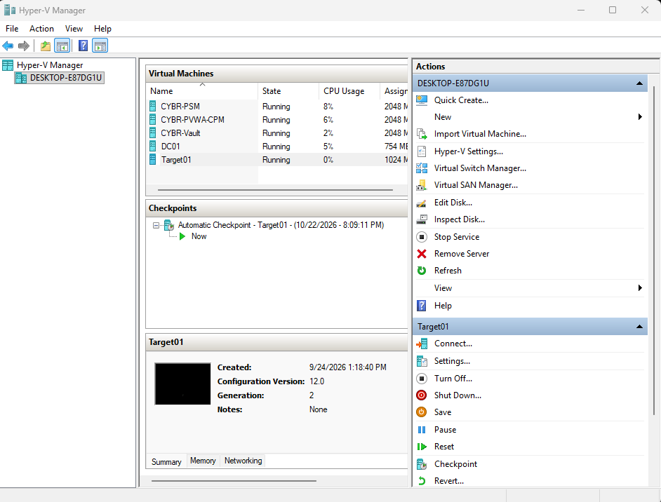
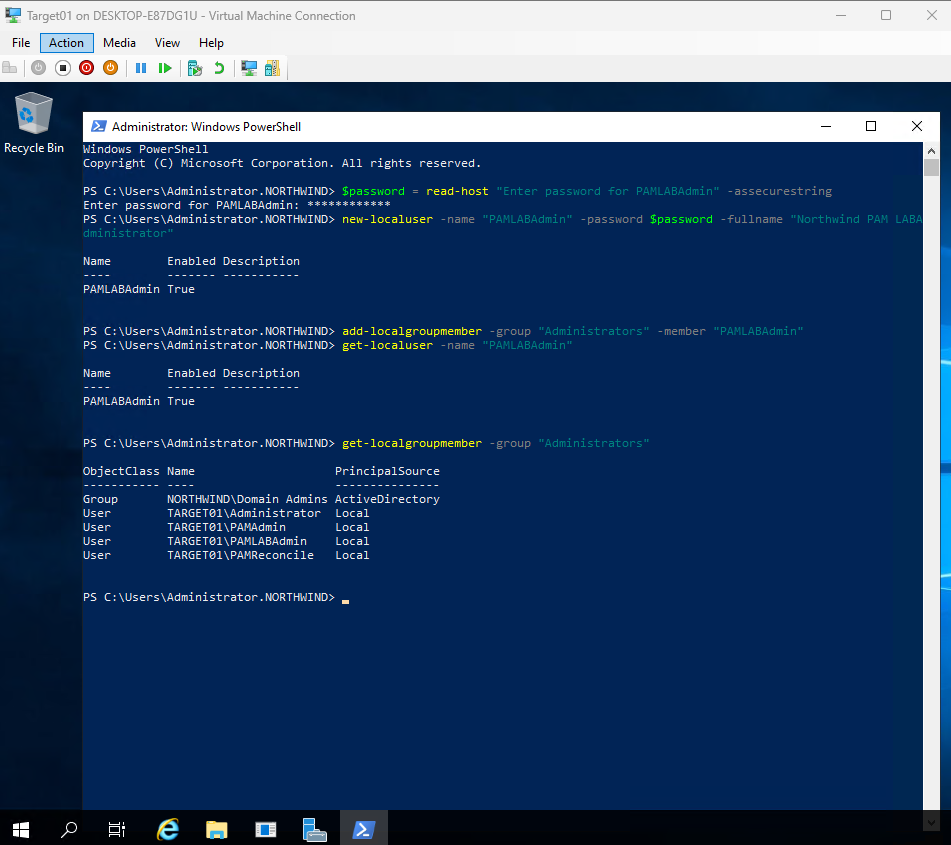
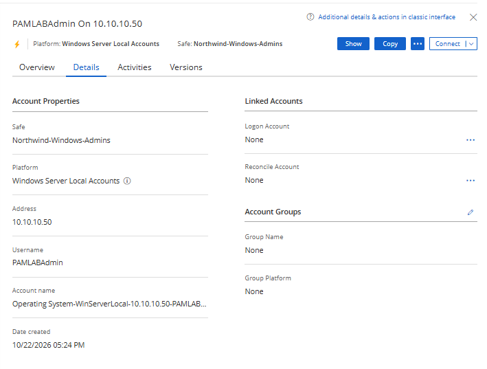
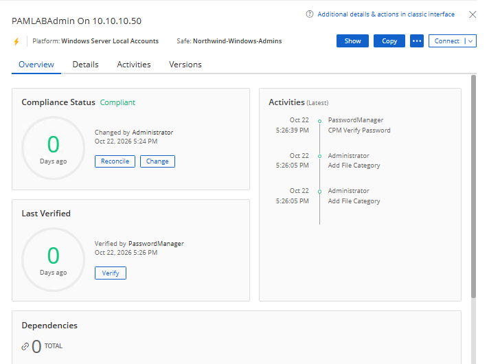
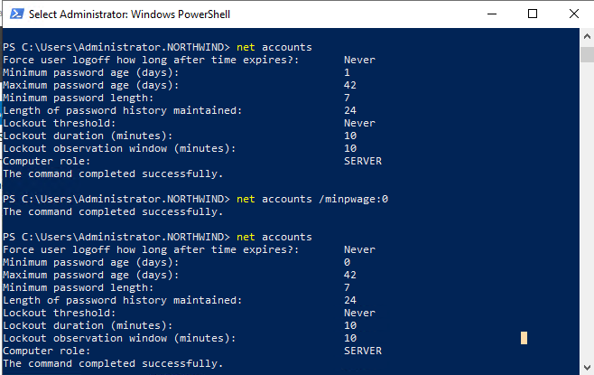
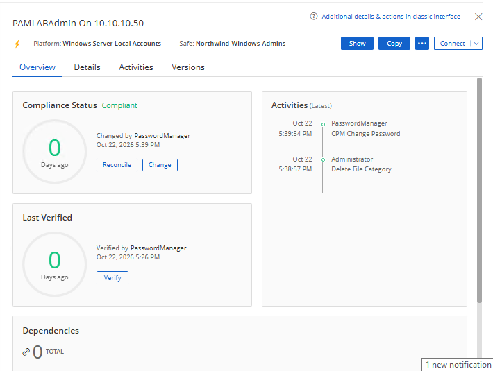
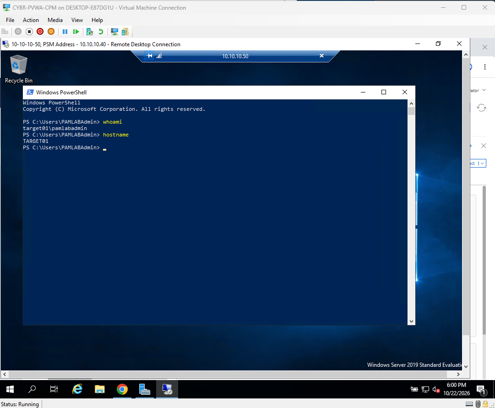

<h1>CyberArk PAM: Privileged Account Onboarding and Credential Management</h1>
In this lab, we used CyberArk Privileged Access Manager (PAM) to onboard a Windows local administrator account, verify and rotate its password using Central Policy Manager (CPM), and establish an RDP session through Privileged Session Manager (PSM). We also investigated a password rotation error related to Windows password policy. This lab demonstrates how CyberArk manages privileged credentials and allows access to a target system without revealing the rotated password. <br />

<h2>Environments and Technologies Used</h2>

- Microsoft Hyper-V
- CyberArk Digital Vault, Password Vault Web Access (PVWA), Central Policy Manager (CPM), Privileged Session Manager (PSM)
- Windows PowerShell
- Windows Local Users and Groups
- Remote Desktop (RDP)

<h2>Operating Systems Used</h2>

- Windows Server (TARGET01: Windows Server 2019)

<h2>High-Level Steps</h2>

- Step 1. Review CyberArk Lab Environment
- Step 2. Create a Windows Privileged Account
- Step 3. Onboard Account into CyberArk
- Step 4. Verify Account Password using CPM
- Step 5. Troubleshoot Password Policy and Rotate Password
- Step 6. Connect to TARGET01 through PSM

> [!IMPORTANT]
> Each step includes written instructions followed by a corresponding screenshot. The **See screenshots** sections are opened by default, but can still be collapsed.

<h2>Actions and Observations</h2>

<b>1. CYBERARK LAB ENVIRONMENT</b>

Open Hyper-V Manager and start our five virtual machines. We have a domain controller (DC01), CyberArk Vault (CYBR-Vault), PVWA and CPM server (CYBR-PVWA-CPM), PSM server (CYBR-PSM), and our target Windows server (TARGET01).

- DC01: `10.10.10.10`
- CYBR-Vault: `10.10.10.20`
- CYBR-PVWA-CPM: `10.10.10.30`
- CYBR-PSM: `10.10.10.40`
- TARGET01: `10.10.10.50`

Confirm all five VMs are running before we continue. Each CyberArk server has a separate role: PVWA is our web interface, CPM manages the passwords, and PSM handles the privileged sessions.

<details open><summary>See screenshots</summary>



</details>

<b>2. CREATE A WINDOWS PRIVILEGED ACCOUNT</b>

On TARGET01, open PowerShell as Administrator. Create a local account named `PAMLabAdmin` and add it to the local Administrators group. We will onboard this account into CyberArk in the next step.

```powershell
$Password = Read-Host "Enter password for PAMLabAdmin" -AsSecureString
New-LocalUser -Name "PAMLabAdmin" -Password $Password -FullName "Northwind PAM Lab Administrator"
Add-LocalGroupMember -Group "Administrators" -Member "PAMLabAdmin"
```

Verify the account and its group membership using PowerShell.

```powershell
Get-LocalUser -Name "PAMLabAdmin"
Get-LocalGroupMember -Group "Administrators"
```

Observe that `PAMLabAdmin` is enabled and listed under the local Administrators group. At this point, the account exists on Windows but is not yet managed by CyberArk.

<details open><summary>See screenshots</summary>



</details>

<b>3. ONBOARD ACCOUNT INTO CYBERARK</b>

On CYBR-PVWA-CPM, sign into PVWA as Administrator. Go to **Accounts**, select **Add Account**, and choose Windows for the system type. Enter the following information:

- Platform: Windows Server Local Accounts
- Safe: `Northwind-Windows-Admins`
- Address: `10.10.10.50`
- Username: `PAMLabAdmin`
- Password: the existing Windows password created in Step 2

Select **Add**. Open the account details and confirm the username, target address, platform, and Safe. The account is now onboarded into CyberArk.

<details open><summary>See screenshots</summary>



</details>

<b>4. VERIFY THE MANAGED PASSWORD</b>

Open `PAMLabAdmin` in PVWA and select **Verify**. This tells CPM to check whether the password stored in the Vault works on TARGET01.

Observe the **Last Verified** section and the **CPM Verify Password** activity. Verification completed successfully, confirming that CyberArk can authenticate with the stored credential.

<details open><summary>See screenshots</summary>



</details>

> [!NOTE]
> Verify checks the current password; it does not change it. We will use **Change** for password rotation.

<b>5. PASSWORD ROTATION AND WINDOWS PASSWORD POLICY</b>

Back in the account overview, select **Change** to rotate the password. Leave **Change password only in Vault** and **Specify password for next CPM Change** unchecked, so CPM can perform a normal managed rotation.

Our first attempt returned `winRc=2245`, stating that the new password did not meet Windows password policy requirements. On TARGET01, open PowerShell as Administrator and inspect the account policy.

```powershell
net accounts
```

Notice that **Minimum password age (days)** was set to `1`. Because we created the account recently, we checked this restriction before changing CyberArk's password-generation settings. For this isolated lab, set the minimum password age to zero and review the policy again.

```powershell
net accounts /minpwage:0
net accounts
```

Observe that **Minimum password age (days)** now displays `0`.

<details open><summary>See screenshots</summary>



</details>

Return to PVWA and select **Change** again. This time, CPM successfully rotated the password. The account overview shows **Changed by PasswordManager** and a **CPM Change Password** activity.

<details open><summary>See screenshots</summary>



</details>

> [!NOTE]
> The successful retry after the minimum-password-age adjustment supports this as the cause of our lab's rotation failure. In a production environment, password-policy changes should follow approved security requirements.

<b>6. CONNECT TO TARGET01 THROUGH PSM</b>

Now that CPM has rotated the password, go back to the `PAMLabAdmin` account and select **Connect**. Enter a connection reason and select TARGET01 as the destination. Launch the RDP connection.

Notice that the RDP connection first goes through our PSM server (`10.10.10.40`). PSM brokers the session to TARGET01 (`10.10.10.50`) using the managed account, without us having to view or type the new password.

Inside the PSM RDP session, open PowerShell and run:

```powershell
whoami
hostname
```

Observe that `whoami` returns `target01\pamlabadmin` and `hostname` returns `TARGET01`. This confirms we established a privileged session on the correct server using the rotated credential.

<details open><summary>See screenshots</summary>



</details>

This lab demonstrates how CyberArk centralizes privileged account management through credential verification, automated password rotation, and secure PSM sessions, allowing administrators to access target systems without exposing privileged credentials.
